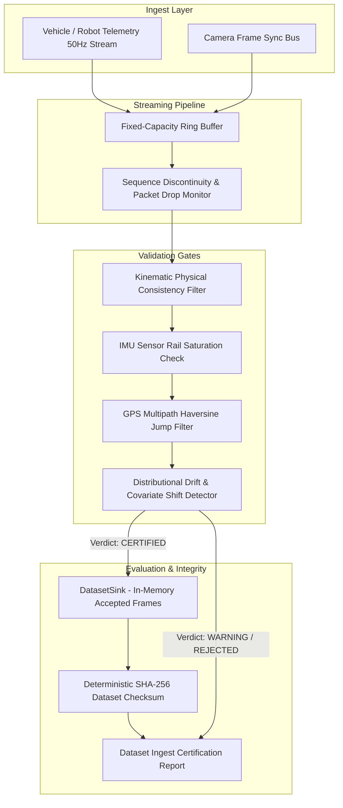

# Telemetry Eval Engine

> **Autonomous Vehicle Telemetry Ingestion, Anomaly Detection & Dataset Integrity Checks**
> *Engineered by elura172 ([@elura172](https://github.com/elura172)) · Tokyo Relocation Pipeline Candidate*
> Independent portfolio prototype; not affiliated with Woven by Toyota.

[](https://www.python.org/)
[](LICENSE)
[-brightgreen.svg)](#evaluation-benchmark)
[](#the-problem-automotive-scale-data-certification)

---

## The Problem: Automotive-Scale Data Certification

Autonomous driving (AD/ADAS) and smart city robotics platforms (such as **Woven by Toyota** and Woven City) ingest millions of high-frequency sensor frames daily across CAN bus, IMU, GPS, and camera sync telemetry.

Feeding raw, unverified streams directly into model training or labeling pipelines introduces catastrophic data quality risks:

1. **Undetected Sequence Drops & Clock Jitter:** Sensor timing anomalies that corrupt trajectory prediction and SLAM localization.
2. **Sensor Hardware Saturation:** Accelerometers and gyroscopes clipping during harsh maneuvers, contaminating neural network gradient updates with non-physical values.
3. **GPS Multipath Teleportation:** Urban canyon reflections (e.g., Tokyo's Nihonbashi and Shuto Expressway tunnels) producing apparent velocities in excess of $80\text{ m/s}$.
4. **Covariate Distribution Shift:** Unmonitored distribution drift between simulated simulator driving and real-world rain/night runs.

**Telemetry Eval Engine** is an in-memory reference implementation that validates physical constraints, tracks frame sequence continuity, flags speed-mean shifts, and computes checksums for accepted frames. The bounded ring buffer applies explicit backpressure; the demo pipeline drains it as input arrives. This project does not provide durable storage, a production transport, or a formal training-data certification standard.

---

## Architectural Overview



---

## Core Capabilities

### 1. Fixed-Capacity Ring Buffer
* **Backpressure Management:** Fixed-capacity circular buffer rejects writes while full; callers must drain and retry.
* **Sequence Continuity Tracking:** Counts missing frame IDs and rejects duplicate or out-of-order IDs.

### 2. Multi-Tier Anomaly & Physics Verification
* **Kinematic Limits:** Enforces physical tire friction coefficients (max lateral acceleration $8.5\text{ m/s}^2$) and longitudinal limits.
* **IMU Rail Saturation Filter:** Catches sensor clipping ($>30\text{ m/s}^2$).
* **GPS Teleportation Guard:** Estimates apparent speed between consecutive coordinates and flags jumps above a configured limit.

### 3. Distributional Drift Detection
* Compares the batch mean speed with a configured baseline mean and standard deviation. This is a simple z-score gate; it does not calculate Wasserstein distance or model a full feature distribution.

### 4. Dataset Content Integrity Check
* Computes a deterministic SHA-256 checksum over canonical JSON for every accepted frame, including metadata. This detects content changes in the hashed stream; it does not sign the report or establish external provenance.

---

## Evaluation Benchmark

The repository includes a fixed 10-scenario synthetic suite covering physical limits, sensor faults, and quality gate outcomes:

| Scenario | Objective | Expected Verdict | Anomalies | Result |
|---|---|---|---|---|
| `01_PRISTINE_HIGHWAY_RUN` | Clean 50Hz telemetry along Tokyo Expressway | `CERTIFIED` | 0 | **PASS** |
| `02_GPS_MULTIPATH_TELEPORTATION` | Sudden 5km coordinate jump (tunnel reflection) | `REJECTED` | `GPS_MULTIPATH_JUMP` | **PASS** |
| `03_IMU_SENSOR_RAIL_SATURATION` | Accelerometer saturation spike (45 m/s^2) | `REJECTED` | `IMU_SATURATION` | **PASS** |
| `04_KINEMATIC_LATERAL_VIOLATION` | Lateral acceleration exceeding road tire friction | `WARNING` | `KINEMATIC_VIOLATION` | **PASS** |
| `05_HIGH_DROPPED_FRAME_BURST` | 15 dropped packets detected via sequence gaps | `REJECTED` | 15 drops | **PASS** |
| `06_SINGLE_PACKET_DROP_TOLERANCE` | Isolated single frame drop | `WARNING` | 1 drop | **PASS** |
| `07_DISTRIBUTIONAL_SPEED_DRIFT` | Covariate speed shift exceeding 3-sigma bounds | `REJECTED` | `DISTRIBUTION_DRIFT` | **PASS** |
| `08_TIMESTAMP_JITTER_DETECTION` | Clock jitter exceeding 15ms tolerance window | `WARNING` | `TIMESTAMP_JITTER` | **PASS** |
| `09_CAMERA_SYNC_ID_CONSISTENCY` | Deterministic camera sync ID sequence alignment | `CERTIFIED` | 0 | **PASS** |
| `10_CRYPTOGRAPHIC_REPRODUCIBILITY` | Matching SHA-256 checksums across parallel ingest runs | `CERTIFIED` | 0 | **PASS** |

**Synthetic benchmark:** **10 / 10 scenarios pass** in the included simulator. This score describes these fixed scenarios only; it is not a field-performance or real-world accuracy estimate.

## Real-Trajectory Diagnostic

The repository also includes a 600-row excerpt of FHWA's video-derived NGSIM trajectories. The source provides vehicle acceleration in ft/s² at 10 Hz, not GPS/IMU signals or sensor-fault labels. The diagnostic converts acceleration to m/s² and evaluates only the longitudinal acceleration plausibility gate. Source, license, query, sample checksum, and scope are recorded in [`data/README.md`](data/README.md).

Run it with:

```bash
uv run python -m src.evals.ngsim_real_data --output reports/ngsim_real_data_eval.json
```

On the bundled sample, the unmodified trace produced 0 gate alarms across 600 rows. With two explicitly injected value edits, the gate detected the 13.0 m/s² edit and missed the 11.5 m/s² edit because it falls below the configured 12.0 m/s² limit: 1 true positive, 0 alarms on unmodified rows, and 1 miss. The report includes the clean-baseline assumption and measured detector-only throughput. These are diagnostic injection results, not real-world fault-detection accuracy; NGSIM supplies no fault labels.

---

## Quickstart

### Prerequisites
* Python 3.11+
* [`uv`](https://github.com/astral-sh/uv) (recommended) or `pip`

### 1. Run Interactive Terminal Demo
Experience a simulated 50Hz telemetry stream, anomaly detection, and dataset integrity checks:
```bash
git clone https://github.com/elura172/telemetry-eval-engine.git
cd telemetry-eval-engine
uv run demo.py
```

### 2. Run Test Suite
```bash
uv run pytest -v
```

---

## Project Structure

```
telemetry-eval-engine/
├── demo.py                   # Rich terminal demo showing live 50Hz stream & evals
├── pyproject.toml            # Project specification & uv dependencies
├── README.md                 # System documentation & benchmark scorecard
├── data/                     # Attributed NGSIM sample and provenance
├── reports/                  # Real-trace evaluation output
├── src/
│   ├── models/
│   │   └── types.py          # Telemetry frames, anomalies, certification verdicts
│   ├── telemetry/
│   │   ├── stream.py         # ZeroLossBuffer ring buffer & Tokyo highway simulator
│   │   └── sink.py           # DatasetSink, SHA-256 checksums & IngestPipeline
│   ├── validation/
│   │   └── detector.py       # Kinematic physics filters, GPS jump & drift detection
│   └── evals/
│       ├── harness.py        # 10-scenario synthetic evaluation suite
│       └── ngsim_real_data.py # Real-trajectory acceleration diagnostic
└── tests/
    ├── test_telemetry.py     # Synthetic unit and integration tests
    └── test_ngsim_eval.py    # Real-sample reproducibility checks
```

---

## Author & Contact

**elura172**  
*AI Systems & Data Infrastructure Engineer*  
* **GitHub:** [github.com/elura172](https://github.com/elura172)  
* **Email:** [228485553+elura172@users.noreply.github.com](mailto:228485553+elura172@users.noreply.github.com)  
* **Target:** Tokyo Relocation Pipeline / Woven by Toyota Enterprise AI Platform
