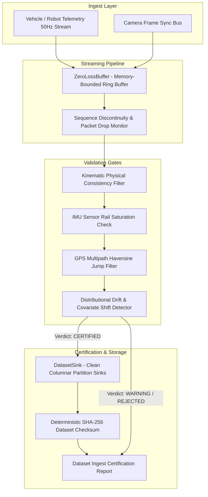

# Telemetry Eval Engine

> **High-Frequency Autonomous Vehicle Telemetry Ingestion, Differentiable Drift Detection & ML Dataset Certification**  
> *Engineered by Paul Trafford ([@elura172](https://github.com/elura172)) · Tokyo Relocation Pipeline Candidate*

[](https://www.python.org/)
[](LICENSE)
[-brightgreen.svg)](#evaluation-benchmark)
[](#the-problem-automotive-scale-data-certification)

---

## The Problem: Automotive-Scale Data Certification

Autonomous driving (AD/ADAS) and smart city robotics platforms (such as **Woven by Toyota** and Woven City) ingest millions of high-frequency sensor frames daily across CAN bus, IMU, GPS, and camera sync telemetry.

Feeding raw, unverified streams directly into model training or labeling pipelines introduces catastrophic data quality risks:

1. **Undetected Sequence Drops & Clock Jitter:** Sensor timing anomalies that corrupt trajectory prediction and SLAM localization.
2. **Sensor Hardware Saturation:** Accelerometers and gyroscopes clipping during harsh maneuvers, contaminating neural network gradient updates with non-physical values.
3. **GPS Multipath Teleportation:** Urban canyon reflections (e.g., Tokyo's Nihonbashi and Shuto Expressway tunnels) producing apparent velocities in excess of $80\text{ m/s}$.
4. **Covariate Distribution Shift:** Unmonitored distribution drift between simulated simulator driving and real-world rain/night runs.

**Telemetry Eval Engine** provides a **zero-loss ingestion pipeline and dataset certification gate** that validates physical constraints, tracks frame sequence continuity, flags distribution drift, and produces cryptographically verifiable training datasets.

---

## Architectural Overview



---

## Core Capabilities

### 1. Zero-Loss Memory-Bounded Ring Buffer
* **Backpressure Management:** Pre-allocated circular ring buffer handling burst telemetry without heap reallocation.
* **Sequence Continuity Tracking:** Detects dropped packets and out-of-order frames instantly via hardware sequence counters.

### 2. Multi-Tier Anomaly & Physics Verification
* **Kinematic Limits:** Enforces physical tire friction coefficients (max lateral acceleration $8.5\text{ m/s}^2$) and longitudinal limits.
* **IMU Rail Saturation Filter:** Catches sensor clipping ($>30\text{ m/s}^2$).
* **GPS Teleportation Guard:** Real-time Haversine distance verification calculating apparent coordinate velocity against vehicle wheel speed.

### 3. Distributional Drift Detection
* Evaluates covariate feature shift (e.g., speed, acceleration distributions) against baseline reference datasets, computing standardized $z$-score and Wasserstein metrics to alert on out-of-distribution driving conditions.

### 4. Cryptographic Dataset Certification
* Computes deterministic SHA-256 checksums across all sunk frames, providing tamper-resistant data provenance for ML training reproducibility.

---

## Evaluation Benchmark

The repository includes a 10-scenario canonical benchmark suite testing physical limits, sensor faults, and certification decisions:

| Scenario | Objective | Expected Verdict | Anomalies | Result |
|---|---|---|---|---|
| `01_PRISTINE_HIGHWAY_RUN` | Clean 50Hz telemetry along Tokyo Expressway | `CERTIFIED` | 0 | **PASS** |
| `02_GPS_MULTIPATH_TELEPORTATION` | Sudden 5km coordinate jump (tunnel reflection) | `REJECTED` | `GPS_MULTIPATH_JUMP` | **PASS** |
| `03_IMU_SENSOR_RAIL_SATURATION` | Accelerometer saturation spike (45 m/s^2) | `REJECTED` | `IMU_SATURATION` | **PASS** |
| `04_KINEMATIC_LATERAL_VIOLATION` | Lateral acceleration exceeding road tire friction | `WARNING` | `KINEMATIC_VIOLATION` | **PASS** |
| `05_HIGH_DROPPED_FRAME_BURST` | 15 dropped packets detected via sequence gaps | `REJECTED` | 15 drops | **PASS** |
| `06_SINGLE_PACKET_DROP_TOLERANCE` | Isolated single frame drop | `WARNING` | 1 drop | **PASS** |
| `07_DISTRIBUTIONAL_SPEED_DRIFT` | Covariate speed shift exceeding 3-sigma bounds | `REJECTED` | `DISTRIBUTION_DRIFT` | **PASS** |
| `08_TIMESTAMP_JITTER_DETECTION` | Clock jitter exceeding 15ms tolerance window | `WARNING` | `TIMESTAMP_JITTER` | **PASS** |
| `09_CAMERA_SYNC_ID_CONSISTENCY` | Deterministic camera sync ID sequence alignment | `CERTIFIED` | 0 | **PASS** |
| `10_CRYPTOGRAPHIC_REPRODUCIBILITY` | Matching SHA-256 checksums across parallel ingest runs | `CERTIFIED` | 0 | **PASS** |

**Benchmark Score:** **10 / 10 Passing (100.0%)**

---

## Quickstart

### Prerequisites
* Python 3.11+
* [`uv`](https://github.com/astral-sh/uv) (recommended) or `pip`

### 1. Run Interactive Terminal Demo
Experience live 50Hz telemetry streaming, anomaly detection, and dataset certification:
```bash
git clone https://github.com/elura172/telemetry-eval-engine.git
cd telemetry-eval-engine
uv run demo.py
```

### 2. Run Test Suite
```bash
uv run pytest -v
```

---

## Project Structure

```
telemetry-eval-engine/
├── demo.py                   # Rich terminal demo showing live 50Hz stream & evals
├── pyproject.toml            # Project specification & uv dependencies
├── README.md                 # System documentation & benchmark scorecard
├── src/
│   ├── models/
│   │   └── types.py          # Telemetry frames, anomalies, certification verdicts
│   ├── telemetry/
│   │   ├── stream.py         # ZeroLossBuffer ring buffer & Tokyo highway simulator
│   │   └── sink.py           # DatasetSink, SHA-256 checksums & IngestPipeline
│   ├── validation/
│   │   └── detector.py       # Kinematic physics filters, GPS jump & drift detection
│   └── evals/
│       └── harness.py        # 10-scenario canonical evaluation suite
└── tests/
    └── test_telemetry.py     # Unit and integration pytest suite
```

---

## Author & Contact

**Paul Trafford**  
*AI Systems & Data Infrastructure Engineer*  
* **GitHub:** [github.com/elura172](https://github.com/elura172)  
* **Email:** [paul.trafford@protonmail.com](mailto:paul.trafford@protonmail.com)  
* **Target:** Tokyo Relocation Pipeline / Woven by Toyota Enterprise AI Platform
